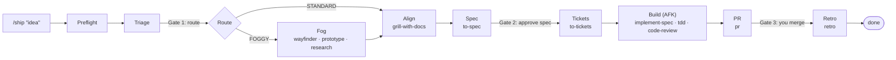

# dev-harness

**Ship a feature from one sentence.** dev-harness is a [Claude Code](https://claude.com/claude-code) plugin that runs [Matt Pocock's skills](https://github.com/mattpocock/skills) workflow end to end:

```text
/ship "Add a --version flag that prints 0.1.0"
```

Triage, alignment, spec, tickets, a parallel test-first build, code review, a structured pull request and a retrospective all happen in order. Claude only stops when a decision is yours.

- **Gated:** the run stops for you at the route, the spec and the PR merge, and never approves a gate on your behalf.
- **Resumable:** progress lives in a state file, so a crash, a closed laptop or a new day doesn't lose your place.
- **Away-from-keyboard build:** a Stop hook keeps Claude working through the tickets until they're done or blocked.
- **Guarded:** a hook blocks force-pushes, pushes to your default branch, PR merges and tampering with the run's state.

## How a run flows



| Phase | What happens | Skills used |
|---|---|---|
| **Preflight** | Checks git, a clean tree, `gh` login and the installed skills; creates `harness/<slug>`; sets up the issue tracker on first use | `setup-matt-pocock-skills` |
| **Triage** | Three questions decide the route: **FOGGY** if the architecture is unknown, **STANDARD** otherwise | `harness-triage` |
| **Fog** *(FOGGY only)* | Maps open decisions, answers each with a throwaway prototype or cited research, and commits `map.md`. The prototype code is deleted. | `wayfinder`, `prototype`, `research` |
| **Align** | An interview with you; domain terms go into `GLOSSARY.md` | `grill-with-docs`, `domain-modeling` |
| **Spec** | Writes `docs/specs/<slug>/spec.md` | `to-spec` |
| **Tickets** | Slices the spec into vertical tickets as GitHub issues | `to-tickets` |
| **Build** | Implements tickets in isolated worktrees: red-green-refactor, then a fresh-context review. A failing ticket is retried 3 times, then blocked, and the rest continue. | `implement-spec`, `implement`, `tdd`, `code-review` |
| **PR** | Opens a PR with evidence, merge danger (one-way or two-way door) and blast radius | `pr` |
| **Retro** | Audits the run and writes proposals to `.harness/retros/<slug>.md`; nothing is applied automatically | `retro` |

## Requirements

- [Claude Code](https://claude.com/claude-code) (the `claude` CLI)
- [Matt Pocock's skills](https://github.com/mattpocock/skills) plugin:
  ```bash
  claude plugin marketplace add mattpocock/skills
  claude plugin install mattpocock-skills@mattpocock
  ```
- [GitHub CLI](https://cli.github.com) logged in (`gh auth login`); tickets and PRs go to GitHub
- Python 3.10 or newer (the harness uses only the standard library)
- git 2.31 or newer

## Install

**Install for every session.** This repo is its own plugin marketplace (`sdd-harness`):

```bash
claude plugin marketplace add Aragami007/dev-harness
claude plugin install dev-harness@sdd-harness
```

The repo is private, so git must be able to clone it with your GitHub login. If the first command fails to clone, run `gh auth setup-git` once and try again.

**Or try it for one session** from a local clone, without installing anything:

```bash
git clone https://github.com/Aragami007/dev-harness.git
cd /path/to/your-project
claude --plugin-dir /path/to/dev-harness
```

Once installed, the hooks run in every Claude Code session, but they do nothing unless the current repo has an active run. To remove it: `claude plugin uninstall dev-harness@sdd-harness`. To pick up a newer version: `claude plugin marketplace update sdd-harness`.

## Usage

Run these inside the repository you want to change. It must be a GitHub repo with a clean working tree.

| Command | Effect |
|---|---|
| `/ship "<idea>"` | Start a run |
| `/ship --status` | Show the phase, any pending gate, and ticket counts |
| `/ship --resume` | Continue after a gate, a crash or a new day |
| `/ship --abort` | Stop the run; branches, issues and worktrees are left for you to clean up |
| `touch .harness/STOP` | Halt the AFK build loop at its next stop |

The command may show up as `/dev-harness:ship` in the slash-command menu.

### When you're needed

| Moment | Your input |
|---|---|
| Gate 1 | Confirm or override the triage route |
| Align | Answer the `grill-with-docs` interview |
| Gate 2 | Approve the spec, or request changes |
| Tickets | Sign off on the ticket breakdown (asked by `to-tickets` itself) |
| Gate 3 | Review and merge the PR yourself, then say so. The harness checks with GitHub that it's merged before continuing. |

In clients without a question dialog (for example `claude -p`), the harness asks in plain text and ends its turn, and your next message is the answer.

## How it works

```text
.claude-plugin/          plugin.json + marketplace.json
commands/ship.md         the /ship entry point
skills/
  harness-orchestrator/  phase procedures, gates, and the single table of skill names
  harness-triage/        FOGGY vs STANDARD questionnaire
hooks/
  hooks.json             registers the two hooks below
  build_loop.py          Stop hook: the AFK build loop
  guard.py               PreToolUse hook: safety rails
scripts/
  state.py               state machine + CLI, the only writer of .harness/state.json
  tickets_sync.py        mirrors ticket status to GitHub labels (one-way)
  preflight.py           environment checks, .gitignore, skill path map
tests/                   pytest suite (146 tests)
```

- **State machine.** Every phase change goes through `state.py`, which enforces the transition table and the gates. Claude can't skip from align to build, or leave the spec phase without your approval. Writes are atomic and file-locked, so parallel ticket updates don't overwrite each other.
- **Build loop.** When Claude stops during the build phase, `build_loop.py` checks the state. If tickets are still runnable, it hands Claude a fixed "keep going" message listing them. It stops at a gate, at 50 continuations, when every ticket is done or blocked, or when `.harness/STOP` exists. The message is built only from re-validated state fields, so a hostile `state.json` committed to a cloned repo can't inject instructions.
- **Guard.** `guard.py` blocks direct edits to the state file always. While a run is active, it also blocks force-pushes, pushes to the default branch, `gh pr merge`, and merges into the default branch. It understands combined flags (`-fu`), `git -C`, `HEAD`/`@` refspecs, multi-line commands, glued `&&`/`;`, and `bash -c` / `bash -lc` strings.
- **Running Matt's skills.** Most of Matt's workflow skills set `disable-model-invocation: true`, so the Skill tool can't start them. Preflight writes `.harness/skills.json` mapping each skill to its `SKILL.md`, and the orchestrator follows that file directly. You started them by running `/ship`.
- **Labels.** Tickets carry `harness:ticket` plus one of `harness:ready`, `harness:in-progress`, `harness:done` or `harness:blocked`.

Files a run creates in your repo: `.harness/` (ignored by git, except `.harness/retros/`), `docs/specs/<slug>/`, `docs/agents/`, `CLAUDE.md` (on first setup) and possibly `GLOSSARY.md`.

## Limitations

- **The guard is best-effort.** It stops an agent's accidental commands, not a determined attacker: `eval`, scripts and aliases can hide anything.
- **The Stop hook affects other sessions in the same repo.** During the build phase, any Claude session there is kept going. Run other sessions elsewhere, or `touch .harness/STOP`.
- **GitHub only.** GitHub Issues is the only supported tracker.
- **Older git.** On git versions before 2.31, the repo root falls back to the working directory, so a session inside a worktree won't see the run.

## Development

```bash
python3 -m venv .venv && .venv/bin/pip install pytest
.venv/bin/pytest -q -W error
```

| Document | What it covers |
|---|---|
| [docs/superpowers/specs/2026-11-07-dev-harness-design.md](docs/superpowers/specs/2026-11-07-dev-harness-design.md) | Design spec: phases, state schema, failure handling |
| [docs/superpowers/plans/2026-11-07-dev-harness.md](docs/superpowers/plans/2026-11-07-dev-harness.md) | Task-by-task implementation plan |
| [docs/e2e-dry-run.md](docs/e2e-dry-run.md) | Live end-to-end results for both routes, plus known follow-ups |

When Matt renames a skill upstream, update the skill table in `skills/harness-orchestrator/SKILL.md` and `REQUIRED_SKILLS` in `scripts/preflight.py`. The test suite fails until the two match.

## Credits

The workflow and every phase skill come from [Matt Pocock's skills](https://github.com/mattpocock/skills). dev-harness only orchestrates them, adding the state, gates, hooks and guard around them.
